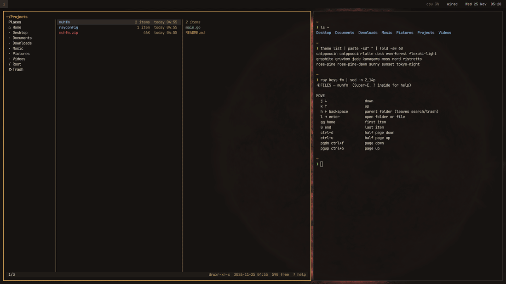
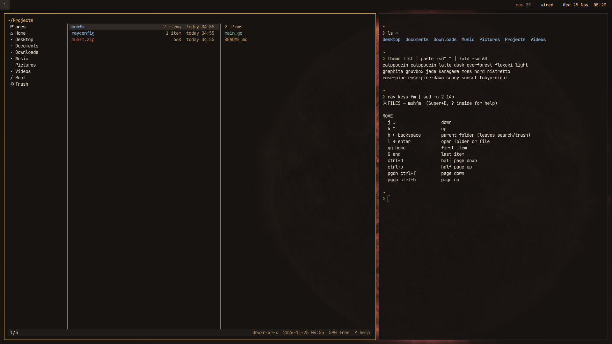
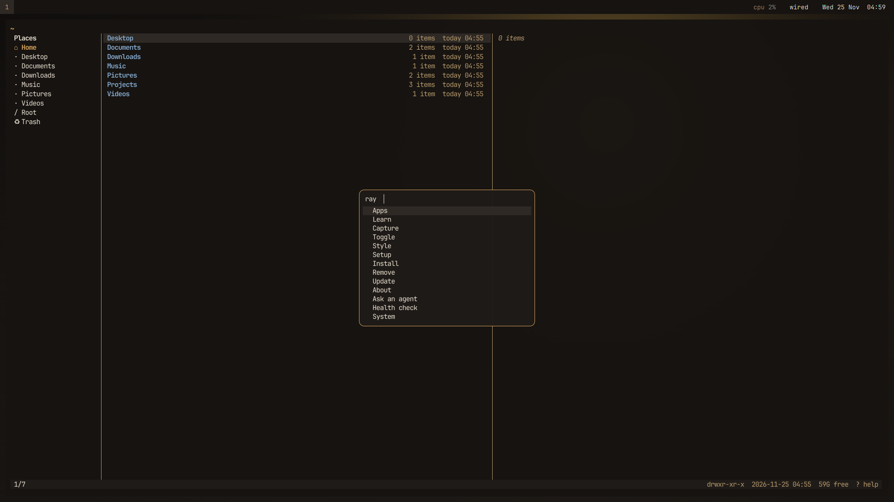
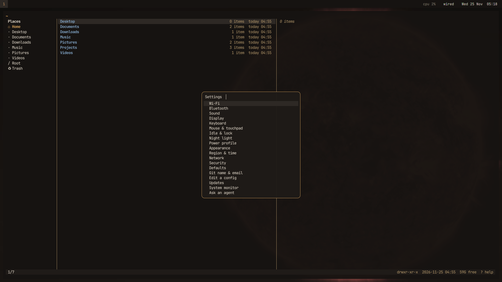
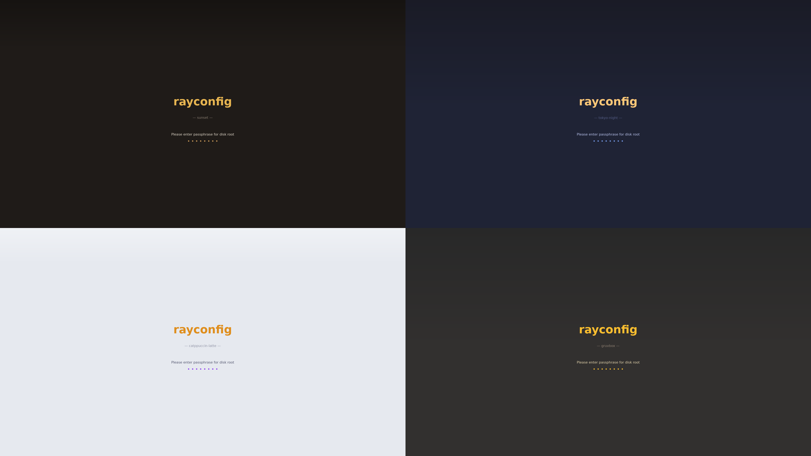
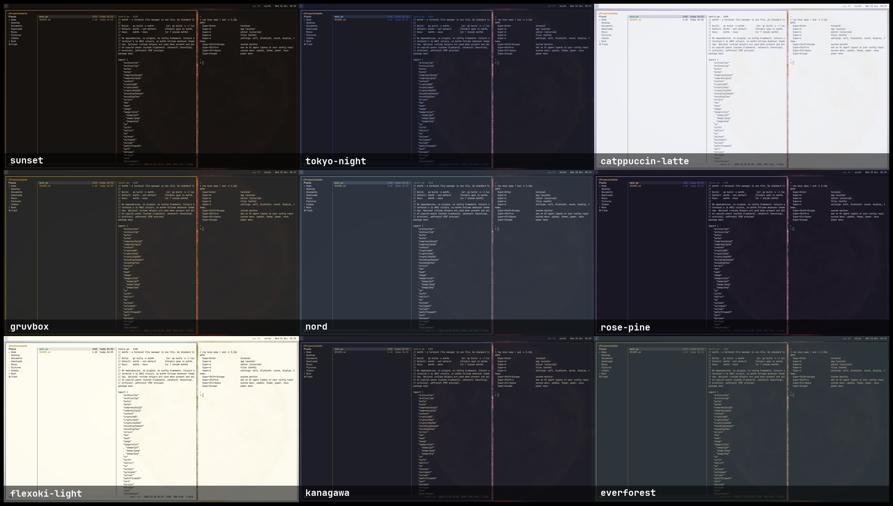
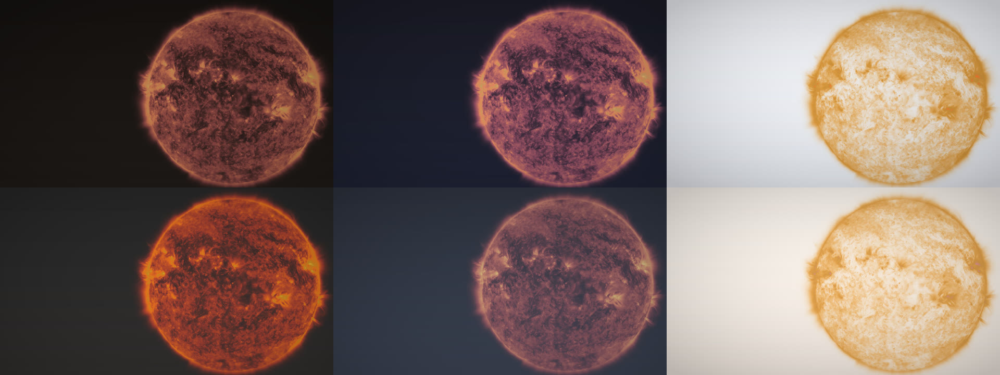
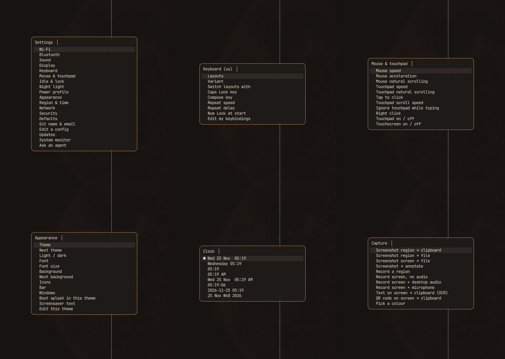

# ☀ Rayconfig

A minimal Wayland desktop you own. Arch + sway, zero plugins, zero plugin
frameworks, no AUR. Built-in bar, built-in lock/idle/wallpaper, and a handful
of shell utilities instead of an ecosystem.

Everything Omarchy gives you — menus for everything, one-key themes that
restyle every app, screenshots and recording, clipboard history, an emoji
picker, web apps, OSD, a screensaver — as small shell functions you can read,
plus [muhfm](https://github.com/apv022/muhfm), a one-file Go file manager that
does what Dolphin does.

17 themes ship: sunset and sunny (solarvim's own), dusk, moss, graphite, jade,
and ports of Tokyo Night, Catppuccin (Mocha and Latte), Gruvbox, Nord,
Everforest, Kanagawa, Rosé Pine (and Dawn), Flexoki Light and Ristretto. One
palette file drives the terminal, compositor, bar, notifications, launcher,
lock screen, file manager, btop, GTK's light/dark choice, wallpaper and Neovim.

<p align="center"></p>

| | |
|---|---|
|  |  |
| desktop: bar, muhfm, foot | `Super+Alt+Space`: everything in one menu |
|  |  |
| `Super+I`: settings | boot splash with the disk password, per theme ¹ |

<p align="center"><br>
<sub>Nine of the 17 themes. Everything in each shot — bar, borders, file manager, terminal, wallpaper — comes from one palette file.</sub></p>

<p align="center"><br>
<sub>The wallpaper is the real Sun: NASA's Solar Dynamics Observatory (AIA 171 Å, courtesy of
NASA/SDO and the AIA science team), recoloured from each palette by
<code>tools/make-wallpaper.py</code>, so the palette stays the only source of colour.</sub></p>

<sub>Screenshots are real: sway running headless, captured with grim. ¹ The splash
preview is drawn by ffmpeg with the plymouth script's exact colours and layout;
the splash itself shows only on a real boot.</sub>

```
themes/<name>/palette  ──►  bin/gen-theme  ──►  every config that has color
```

## Install

### From the Arch ISO — the whole machine, one command

Boot the Arch ISO, connect to the network (`iwctl` for wifi), then:

```sh
curl -fsSL https://raw.githubusercontent.com/apv022/Rayconfig/refs/heads/main/install.sh | sh
```

It detects archiso and runs `bootstrap/iso-install.sh`, which:

1. lists candidate disks (excluding the ISO medium) and asks which one to erase,
2. asks for a username and password, and for you to type the disk name back,
3. GPT-partitions the disk (1 GiB ESP + root on UEFI; bios_grub + 1 GiB /boot + root on BIOS)
   and **encrypts the root with LUKS2** — the same password you log in with
   unlocks it at boot (`--no-encrypt` to skip),
4. refreshes the keyring and `pacstrap`s Arch with a kernel, NetworkManager, sudo, git and curl,
5. writes bootloader, locale, timezone, users and sudoers, and a boot splash
   in your theme (plymouth) that also asks for the disk password,
6. installs Rayconfig into the new user's home and runs the config stage,
7. installs solarvim, makes `nvim` mean solarvim, and starts sway on tty1 login,
8. unmounts and tells you to reboot.

Non-interactive form (still prompts for the password, from `/dev/tty`):

```sh
curl -fsSL <same-url> | sh -s -- --disk /dev/vda --user apv --timezone Europe/Berlin --yes
```

`--dry-run` prints every action without touching a disk. `--fast-mirrors` runs
reflector first. This **destroys the target disk** — there is a typed confirmation
unless you pass `--yes`.

### On an existing Arch system

The same URL, no flags: it detects that you are not on the ISO and only
installs the desktop (packages, configs, theme, verify).

```sh
curl -fsSL https://raw.githubusercontent.com/apv022/Rayconfig/refs/heads/main/install.sh | sh
./install.sh --dry-run
./install.sh --check
```

Options: `--only <stages>`, `--skip <stages>`, `--yes`, `--extras`, `--services`,
`--theme sunny|sunset`.

The repo installs itself to `~/.local/share/rayconfig` and symlinks your configs
into it, so that directory is the live system — `ray update` is a `git pull` plus
a re-link. Set `RAYCONFIG_DIR` to put it elsewhere. Never run the installer from
a temp checkout; it refuses.

There are no versions: the URL, the installer and `ray update` all follow `main`.
GitHub caches the raw file for up to 5 minutes, so right after you change
`install.sh` itself, a fresh install may get the old copy briefly.

## Installed system

| job | tool | why not the alternative |
|---|---|---|
| compositor | `sway` | ships bar, lock, idle, wallpaper, nag — one C stack |
| bar | `swaybar` | the i3bar protocol is stdin JSON; the bar is a shell script, and clicks come back on stdin |
| terminal | `foot` | native Wayland, ~5 libs, config is a file, instant with `--server` |
| files | `muhfm` | one Go file, no deps; tabs, split, trash, archives, drives, previews — default for folders |
| launcher | `fuzzel` | `fuzzel --dmenu` turns anything into a picker |
| notifications | `mako` | dumb renderer, `makoctl` for actions, modes for do-not-disturb, OSD styling |
| clipboard | `cliphist` | `wl-paste --watch` stores, fuzzel picks |
| capture | `grim` + `slurp` + `wf-recorder` | screenshots, recording, colour picking: one `shot` script |
| wallpaper | `swaybg` + generated PNG | gradient derived from the palette, no wallpaper daemon |
| colors | `bin/gen-theme` | ~100 lines of sh + sed instead of a theme framework |

**On the terminal:** `st` is X11-only (XWayland) and its config is a patch queue
you maintain forever. Writing your own means owning a VT parser. `foot` is the
st of Wayland. Alacritty is available with `--extras` if you want to A/B it.

## Settings without the command line

`Super+I` opens the settings hub; every item is a small floating list. Pick a
value and it applies at once — no file to edit, nothing to restart.

<p align="center"></p>

| group | what you can set |
|---|---|
| **Wi-Fi, Bluetooth, Sound** | `impala` / `nmtui`, `bluetui` / `bluetoothctl`, `wiremix` / `pulsemixer` |
| **Display** | per screen: scale, resolution and refresh rate, position (left/right/above/below), rotation, on/off |
| **Keyboard** | layouts (several, with a switch key: Alt+Shift, Ctrl+Shift, both Alts, Caps Lock, Super+Space), variant (intl, Dvorak, Colemak…), Caps Lock as Ctrl / Escape / Backspace / nothing, Compose key, repeat speed, repeat delay, Num Lock at start, your own keybindings |
| **Mouse & touchpad** | mouse speed and acceleration, natural scrolling for each, touchpad speed, tap to click, scroll speed, ignore while typing, two-finger or corner right-click, touchpad on / off / off-with-a-mouse, touchscreen on/off |
| **Idle & lock** | screensaver after, lock after, screen off after (or never), screensaver text, keep awake now |
| **Night light** | on/off, warmth (4500K → candle), schedule |
| **Power profile** | `power-profiles-daemon` |
| **Appearance** | theme, next theme, light/dark, font, font size, background, icons, boot splash, screensaver text; **bar**: top/bottom, solid/clear, 8 clock formats, battery %, CPU; **windows**: gaps, borders or title bars, focus follows mouse, tabbed/stacked new workspaces, terminal transparency |
| **Region & time** | timezone, language, formats (dates, numbers, money, paper), sync the clock |
| **Network** | Wi-Fi, DNS (automatic, Cloudflare, Quad9, Google, custom), computer name, share Wi-Fi as a QR code, speed test |
| **Security** | fingerprint, FIDO2 security key, SSH server, SSH agent, sudo without a password, autologin, password |
| **Defaults** | apps per file type (folders → muhfm, text → solarvim, images → imv, video → mpv, PDF → zathura), web browser, editor |
| **Git, Config** | name and email; open any config in the editor |

Every choice is one line in `~/.local/state/rayconfig/settings` (plain
`key=value`, readable, deletable) and is rendered to
`dots/sway/config.d/85-settings.conf` (gitignored), so it survives updates and
you can still read every line sway runs.

## Omarchy, feature by feature

[Omarchy](https://omarchy.org) gets the *experience* right: one command to a
finished desktop, menus for everything, themes that restyle every app at once,
TUIs instead of GTK settings panels, one-key updates. Rayconfig keeps that
experience and drops the parts that cost ownership: no Hyprland plugin
ecosystem, no AUR, no ~100 scripts. Each row below is one function in `ray`,
one script in `bin/`, or one line of config.

| Omarchy | Rayconfig | where |
|---|---|---|
| one-command install from the ISO | same, `curl … \| sh` | `install.sh` |
| full-disk encryption (LUKS) | on by default, one password for disk and login | `iso-install.sh` |
| Plymouth boot splash | the palette's wordmark, pulsing; the disk password is typed on it | `ray splash`, Menu → Style |
| Omarchy menu (Super+Alt+Space): apps, learn, trigger, style, setup, install, remove, update, about, system | same tree | `ray menu` |
| keybindings cheat sheet | generated from the configs (desktop, editor, files) | `Super+/`, `ray keys` |
| themes that restyle everything | 17 palettes → foot, sway, bar, mako, fuzzel, swaylock, muhfm, btop, GTK, wallpaper, Neovim | `ray theme`, `Super+T`, `Super+Ctrl+T` |
| next background | cycle theme wallpaper + `~/Pictures/wallpapers` | `Super+Ctrl+Space` |
| font picker | one font for every app, plus font size | Appearance → Font, Font size |
| icon theme picker | GTK icon themes, Papirus/Breeze/Adwaita installable | Appearance → Icons |
| bar position, background, clock format, battery % | top/bottom, solid/clear, 8 clock formats, battery and CPU on/off | Appearance → Bar |
| window gaps, borders, workspace layout | gaps size, border size or title bars, tabbed/stacked default, focus follows mouse | Appearance → Windows |
| keyboard layouts, variants, Caps Lock / Compose, repeat | all of it, with a bar indicator for the active layout | Setup → Keyboard |
| mouse / touchpad sensitivity, accel, scroll, tap, gestures | speed, acceleration, scroll speed, tap, dwt, click method, on/off | Setup → Mouse & touchpad |
| idle timers | screensaver, lock, screen off — each adjustable or never | Setup → Idle & lock |
| language and formats, hostname, custom DNS, Wi-Fi QR | `localectl`, `hostnamectl`, NetworkManager | Setup → Region, Network |
| FIDO2, SSH server, SSH agent, passwordless sudo | `pam-u2f`, `openssh`, sudoers drop-in checked by `visudo` | Setup → Security |
| default browser and editor | `xdg-settings`, `$EDITOR` for shells and muhfm | Setup → Defaults |
| git setup | name, email, sane defaults | Setup → Git |
| reminders | systemd user timers + a critical notification | Trigger → Reminder |
| text and QR capture | `tesseract`, `zbar` | Trigger → Capture |
| hardware toggles | laptop screen, touchpad, touchscreen | Trigger → Hardware |
| network and disk speed tests | `speedtest-cli` (or a CDN download), `dd` | Trigger → Speed test |
| install browser / terminal / editor / TUI / dev languages / AI | curated official-repo lists, installed ones ticked | Install |
| restart audio, Wi-Fi, Bluetooth, touchpad | `systemctl`, `swaymsg` | Update → Restart |
| sync time | `timedatectl` | Update → Sync the clock |
| reboot into firmware setup | `systemctl reboot --firmware-setup` | System |
| Hyprland | sway — bar, lock, idle and wallpaper ship in the box | |
| Waybar with click actions | `swaybar` + `bin/status`: click wifi, volume (scroll/right-click), battery, clock, updates | `bin/status` |
| Walker launcher | `fuzzel` | `Super+D` |
| SwayOSD | mako bubble with a progress bar, replaced in place | `bin/vol`, `bin/bright` |
| hyprlock, hypridle | swaylock, swayidle (screensaver 4 min → lock 5 → screen off 10) | `ray idle` |
| screensaver | a sun drifting in theme colours | `ray screensaver` |
| hyprsunset night light | `wlsunset` | `Super+Ctrl+N` |
| idle-lock toggle, do not disturb, toggle bar, gaps, transparency | same, with bar indicators | `Super+Ctrl+I`, `Super+Ctrl+,`, `Super+Shift+Space`, `Super+Shift+Backspace`, `Super+Backspace` |
| screenshots + annotate | `grim`/`slurp`, `satty` | `Super+Shift+S`, `Print`, `Shift+Print` |
| screen recording | `wf-recorder`, `● REC` in the bar | `Super+Alt+R` |
| colour picker (hyprpicker) | `grim` one pixel → `#hex` on the clipboard | `Super+Shift+C` |
| clipboard history | `cliphist` + fuzzel | `Super+Ctrl+V` |
| emoji picker | fuzzel over a plain list | `Super+.` |
| web apps | desktop entries running `chromium --app=…` | `ray webapp`, Menu → Install |
| install / remove packages from a menu | fuzzel over `pacman -Sl` / `pacman -Qe` | `ray install`, `ray remove` |
| fonts install | official `ttf-*` / `otf-*` packages | Menu → Install → Font |
| Nautilus | muhfm: tabs, split, trash, archives, drives, Open With | `Super+E` |
| imv, mpv as defaults | same, via `xdg-mime` | Settings → Default apps |
| btop themed | rendered from the palette | `Super+Shift+Escape` |
| bash with prompt and aliases | `dots/shell/rc.sh`, one line in `~/.bashrc` | `fm` cds where you quit muhfm |
| omarchy-update, firmware, restart pieces | `ray update` (Arch + rayconfig + solarvim + muhfm), `fwupd`, `ray restart` | Menu → Update |
| Wi-Fi, Bluetooth, audio, monitors, power, DNS, timezone, password | TUIs and pickers | `Super+I` |
| fingerprint (fprintd) | enroll + PAM for sudo and swaylock | Settings → Fingerprint |
| autologin | getty drop-in on tty1 | Settings → Autologin |
| low battery warning | critical notification at 10% | `bin/status` |
| hibernate in the power menu | shown when swap exists | `Super+Escape` |
| AUR helpers + AUR packages | official repos only | |
| LazyVim (dozens of plugins) | solarvim: one file, zero plugins | `Super+N` |

Not mapped, on purpose: Omarchy's plugin system and hooks (an extension point
is exactly what Rayconfig refuses), AUR installs, the dock, animations and
rounded corners (sway has none of these), Omarchy's release channels (Rayconfig
follows `main`), dictation and games launchers. Not mapped yet: btrfs
snapshots (an "undo" for the whole system after a bad update) and universal
Super+C/V copy-paste. File sharing with your phone is going into
[Sol](https://github.com/apv022/sol) instead of LocalSend.

## Everyday use

| | |
|---|---|
| `Super+/` | **cheat sheet** — every desktop, editor and file-manager shortcut, generated from the configs |
| `Super+Alt+Space` | menu: apps, learn, capture, toggle, style, setup, install, remove, update, about, system |
| `Super+I` | settings |
| `Super+E` | files (muhfm) |
| `Super+Escape` | power menu |
| `Super+Ctrl+V` · `Super+.` | clipboard history · emoji |
| `Super+Alt+Space` → Trigger | capture (screenshot, record, OCR, QR, colour), reminders, hardware, speed tests |
| `Super+Shift+S` · `Super+Alt+R` · `Super+Shift+C` | screenshot · record · colour picker |
| `ray update` | pulls rayconfig, solarvim and muhfm, then updates Arch and installs anything new — on the running system, no reinstall |
| bar | `↑ N updates` when Arch has updates; click anything to open its setting |

Mod is Super and behaves like Windows: `Super+Left/Right` snap, `Up/Down`
maximise/restore, `Tab` switch window, `E` files, `L` lock, `Enter` terminal,
`D` launcher, `N` editor, `T` light/dark, `.` emoji. Run `ray keys` for the full list.
For vim-style `h/j/k/l` focus, add binds to `~/.config/sway/config.d/90-local.conf`
(gitignored); `ray edit local` opens it.

The cheat sheet has no second copy to maintain: sway's comes from the
`## section` / `# description` comments in `dots/sway/config.d/30-binds.conf`,
solarvim's from the table that creates its mappings, muhfm's from its key table.

## Layout

```
install.sh                 entry point: archiso -> full disk install, Arch -> config install
bootstrap/iso-install.sh   partitioning, pacstrap, bootloader, users, handoff
bootstrap/                 installer stages, package lists
bin/                       ray, status, theme, gen-theme, doctor, keys, vol,
                           bright, shot, snap, winlist
dots/                      hand-written configs; *.in files are templates
dots/shell/rc.sh           prompt, aliases, fm — sourced from ~/.bashrc
templates/                 outputs that live outside the repo (solarvim, btop)
themes/                    palette files + generated wallpaper JPEGs
data/emoji.txt             the emoji picker's list
tools/make-wallpaper.py    dev tool: the Sun recoloured from a palette
tools/sdo-sun-171.png      NASA/SDO image of the Sun, grayscale, the wallpaper's source
test/smoke.sh              dependency-free smoke test
```

muhfm and solarvim are their own repos, cloned to `~/.local/share/` and kept
current by `ray update`. muhfm is built from source with the official `go`
package; nothing is downloaded but the code.

**Editing rule:** edit `*.in`, never the generated file next to it. Generated
files are gitignored and rebuilt by `ray theme`. Wallpapers are generated by
the dev tool and committed; any monitor size is fine (`-m fill`).

## After install

Log in on tty1; sway starts by itself (opt out: `touch ~/.config/rayconfig-no-autostart`).
On an existing Arch box, log in on a TTY and type `sway`.

```sh
ray doctor        # health check, read-only
ray update        # everything up to date
ray theme nord    # any folder in themes/, or toggle | next | prev | list
ray keys          # cheat sheets (sway | vim | fm)
ray menu          # everything else
ray edit          # open the repo in solarvim
```

## Roadmap

- Btrfs snapshots with a rollback entry in the boot menu.
- Rounded corners / blur are not possible without swayfx (a sway fork, AUR).
  Deliberately left out.

## Working on the repo

Read `CLAUDE.md` (also linked as `AGENTS.md`) before changing anything. It has
the ethos, the non-negotiables, the landmines already hit, and the exact
verification commands. Do not "improve" the design by adding plugins, a bar
framework, AUR packages or a second source of truth for colour.

## License

MIT. Palette and Neovim colorscheme adapted from
[solarvim](https://github.com/apv022/SolarVim).
